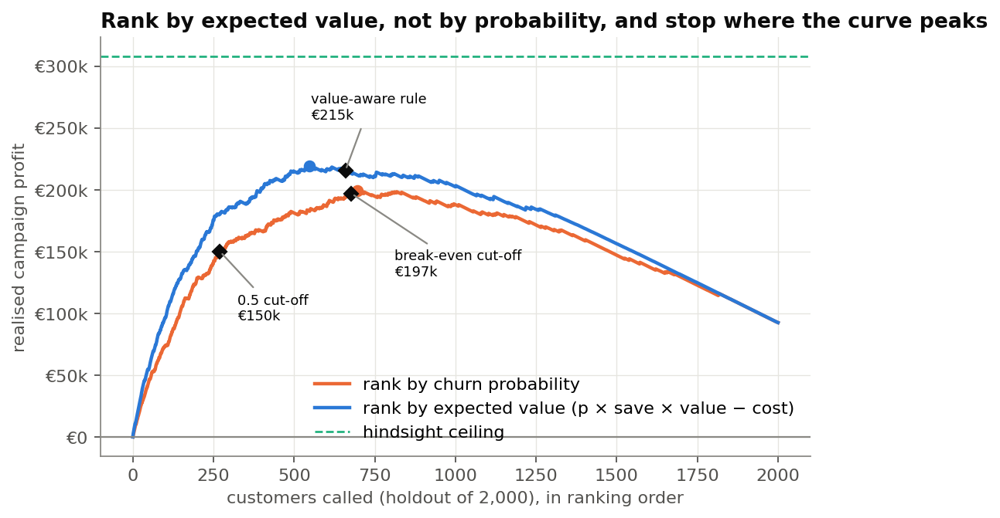

# Bank churn: who will leave, why, and whom to call

**Same churn model, better decision rule: +43% retention-campaign profit.** A public Kaggle churn
notebook (LightGBM + SHAP) reproduced on the same split, audited, and extended from a prediction
into a retention decision.

## The finding

On 2,000 held-out bank customers:

| | Source notebook | This project |
|---|---|---|
| Holdout ROC-AUC | 0.860 | 0.868 (Δ +0.008, 95% CI +0.001 to +0.015) |
| Who gets a call | p ≥ 0.5 (270 customers) | p × save rate × value > cost (659 customers) |
| Realised campaign profit | €150k | **€215k** (+€65k, 95% CI +€44k to +€89k) |
| Share of the hindsight ceiling | 49% | **70%** |

- **The decision rule is worth money; the tuning is not.** The +€65k comes from changing the rule
  on the *source's own model*. Swapping in the tuned model under the same rule changes profit by
  −€2k (CI −€10k to +€6k).
- **Who leaves is not what the source notebook says.** Churn is U-shaped in product count: 1
  product 28%, 2 products 8%, 3–4 products 83–100%. "More products → more churn" is wrong for 97%
  of customers.
- **High-risk customers fall into three personas** (older and disengaged, single-product
  German customers, 3+ product holders), found by clustering SHAP explanations. The 3+ product group
  (87% churned) is a product or mis-selling problem, not a call-list problem.
- **An interpretable scorecard nearly matches the boosted model** (0.853 vs 0.868 AUC) once it is
  given a spline on age and product count as categories. Plain logistic regression scores 0.76.
- **The recommendation is robust:** the value-aware rule beats the 0.5 cut-off in all 25
  save-rate × customer-value scenarios tested.



## Data

*Bank Turnover Dataset*, `barelydedicated/bank-customer-churn-modeling` on Kaggle. **CC0 public
domain.** 10,000 customers × 14 columns (France, Germany, Spain), one row per customer, 20.4% churn.
It is the public parent of the
[Customer Churn Prediction Challenge](https://www.kaggle.com/competitions/churn-competition-pdc)
file used by the [source notebook](https://www.kaggle.com/code/artrocha/customer-churn-prediction-challange-shap-explain).
That file is a noise-added derivative behind a rules gate, so absolute AUCs are not comparable
across the two. Every comparison here re-runs the source pipeline on this data.

`src/acquisition.py` downloads the file without an API token and verifies its SHA-256
(`3996cd1f…eef0a0`, pinned 2026-10-12). The `data/` folder is not committed.

## Method

| Step | What | Where |
|---|---|---|
| EDA | churn by segment with Wilson CIs; effect sizes (Cramér's V, rank-biserial); the Germany/zero-balance confound | `src/eda.py` |
| Reproduce | the source's exact pipeline (scaler + one-hot, LR/RF/LightGBM, same split and folds) | `src/models.py` |
| Improve | raw-unit trees, 4 engineered features, XGBoost, spline scorecard, Optuna (40 trials; fixes a `subsample` no-op in the source) | `src/features.py`, `src/models.py` |
| Evaluate | holdout once; paired bootstrap CIs; calibration (ECE); lift; AUC by country and gender | `src/evaluate.py` |
| Explain | SHAP in raw units; dependence plots; reason codes; personas by k-means on SHAP vectors | `src/explain.py` |
| Decide | customer value; break-even and value-aware rules; profit curves; 25-scenario sensitivity; A/B test sizing; a call list | `src/business.py` |

## Limitations

- **The money is modelled, not measured.** Customer value (3 years of 1.5% deposit spread + €60
  per product), the €130 cost per call and the 20% save rate are assumptions. The direction of the
  result is robust to them; its size is not.
- **A snapshot, not a history.** No dates, so timing leakage cannot be ruled out and *when*
  customers leave cannot be modelled.
- **SHAP is not causal.** Personas describe why the model flags customers, not what would keep them.
  The randomised test sized in the notebook (≈580 customers per arm) is the way to find out.
- **Small cells.** The 3–4 product group is 326 customers.
- **Not the competition file**, so the source's 0.93 leaderboard AUC is not comparable to the
  0.86–0.87 here.

## Deliverables

| | |
|---|---|
| Capstone notebook | [`notebooks/00_bank_churn_final.ipynb`](notebooks/00_bank_churn_final.ipynb) |
| Kaggle edition (generated) | [`notebooks/kaggle/bank-churn-retention-targeting_kaggle.ipynb`](notebooks/kaggle/bank-churn-retention-targeting_kaggle.ipynb) |
| Deck | [`deck/bank-churn-retention-targeting-deck.pptx`](deck/bank-churn-retention-targeting-deck.pptx) |
| Concept course | [`learning/README.md`](learning/README.md) |
| Code walkthroughs | [`src-explained/`](src-explained/) |

## Reproduce

```bash
python -m venv .venv && .venv/Scripts/pip install -r requirements.txt   # Python 3.10
python run_analysis.py      # data → capstone notebook → Kaggle edition (test-run in an empty folder) → deck
pytest -q                   # 18 unit tests
```

There is one computation path: the capstone notebook. It writes every figure to
`outputs/figures/`, which the deck reads. Its last cell asserts every number quoted in its prose.
